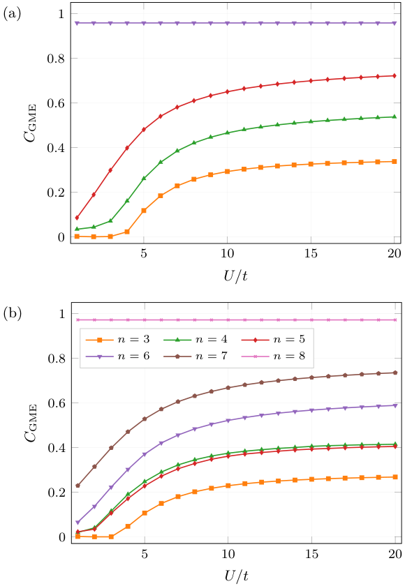

# Genuine multipartite entanglement in ring-shaped Hubbard models

**Genuine multipartite entanglement (GME) of interacting electrons, from exact many-body states to
convex-roof measures, for the Hubbard model and molecular active spaces.**


<p align="center">
  
</p>
<p align="center"><sub>GME concurrence C<sub>GME</sub> of the n-site spin state versus U/t for the
half-filled Hubbard ring, (a) L = 6, (b) L = 8. Full figure: <a href="latex_figs/pdf/fig1.pdf">latex_figs/pdf/fig1.pdf</a>.</sub></p>

---

## Contents

- [What it does](#what-it-does)
- [Quick start](#quick-start)
- [Usage](#usage)
- [Reproducing the paper figures and tables](#reproducing-the-paper-figures-and-tables)
- [Repository layout](#repository-layout)
- [Caching](#caching)
- [Tests](#tests)
- [References](#references)
- [Author](#author)

---

## What it does

Given a many-electron state, `hubbard_gme` extracts the **n-site spin reduced density matrix**
ρ<sub>s</sub> of a cluster of sites and quantifies how much of it is genuinely multipartite
entangled, following Troiani *et al.* (2019).

| Step | What is computed |
|---|---|
| **1. States** | Exact diagonalisation of the 1-D Hubbard Hamiltonian (ring, open chain, next-nearest-neighbour, SSH, ladder; optional nearest-neighbour V), any filling, S<sub>z</sub> = 0 sector or full Hamiltonian |
| **2. RDMs** | n-body (n-site spin) RDMs Γ<sup>(n)</sup> for every cluster, cluster-averaged on the ring |
| **3. GME** | Pure states: C<sub>GME</sub> from all bipartitions. Mixed states: convex roof by the **generalised conjugate gradient (GCG)** on the unitary group, plus Stiefel-manifold solvers and lower bounds |
| **4. Studies** | Ground state vs U/t, V/t and doping; first excited singlet; thermal states C<sub>GME</sub>(n, T); t-scans; molecular active spaces (benzene and others) |
| **5. Output** | Auditable PKL caches of states, RDMs and solver runs; PDF reports; PGFPlots figures whose data lives in the `.tex` file |

---

## Quick start

```bash
git clone https://github.com/ItsKhuramShahzad/hubbard_gme.git
cd hubbard_gme

conda env create -f enviornment_qchem.yml     # environment used for all runs
conda activate qchem
pip install -e .                              # or: export PYTHONPATH=src

# 6-site ring, U/t = 8, n-site RDMs for n = 3 ... 6 and their GME
python main.py --L 6 --t 1.0 --U 8.0 --Ne 6 --min-n 3 --max-n 6

# quick test (~5 s)
python -m pytest tests/test_gcg_transport.py tests/test_separable_boundary.py \
                 tests/test_meyerwallach.py tests/test_measure_param.py -q
```

---

## Usage

<details>
<summary><b>Single-point analysis and topologies</b></summary>

```bash
python main.py                                                       # L=4, U=4, half filling, ring
python main.py --L 6 --U 8.0 --mode uniform --Ne 6 --min-n 3 --max-n 6
python main.py --L 6 --U 4.0 --min-n 3 --max-n 6 --use-pkl-cache --workers 8
python main.py --L 6 --U 4.0 --landscape                             # optimum-landscape analysis
```

| Mode | Lattice | Extra flag |
|---|---|---|
| `uniform` | ring, periodic, all bonds t (default) | — |
| `open` | open chain | — |
| `nnn` | ring + next-nearest-neighbour hopping t′ | `--t-prime` |
| `ssh` | Su–Schrieffer–Heeger, alternating t₁ / t₂ | `--t2` |
| `ladder` | two-leg ladder, leg t, rung t⊥ (even L) | `--t-perp` |

</details>

<details>
<summary><b>Thermal, excited-singlet and parameter scans</b></summary>

```bash
# Thermal GME, C_GME(n, T)
python main.py --thermal --L 6 --U 10.0 --t 1.0 --T-min 0 --T-max 5 --T-steps 40 \
               --min-n 2 --thermal-solver gcg --use-pkl-cache --workers 6

# First excited singlet at T = 0 (add --T-sweep for a temperature sweep)
python main.py --excited-singlet --L 6 --U 10.0 --t 1.0 --min-n 2 \
               --thermal-solver gcg --use-pkl-cache --workers 6

# Ground state versus t (fixed U) and versus U (fixed t)
python main.py --t-scan --L 6 --U 10.0 --t-scan-min 0.05 --t-scan-max 2.0 --t-scan-steps 20 --min-n 2 --use-pkl-cache
python main.py --u-scan --L 6 --t 1.0 --u-scan-min 1.0 --u-scan-max 20.0 --u-scan-steps 20 --min-n 2 --use-pkl-cache

# Extended Hubbard model, V Σ n_j n_{j+1}: U-scan at fixed V, and V-scan (Mott to CDW near V ≈ U/2)
python main.py --u-scan --L 6 --Ne 6 --t 1.0 --u-scan-min 0 --u-scan-max 15 --u-scan-steps 16 \
               --V 5 --full-hamiltonian --min-n 2 --use-pkl-cache --output-prefix V5
python main.py --v-scan --L 6 --Ne 6 --t 1.0 --U 10 --v-scan-min 0 --v-scan-max 15 --v-scan-steps 16 \
               --full-hamiltonian --min-n 2 --use-pkl-cache --output-prefix Vscan_U10
```

`--full-hamiltonian` uses the complete N-electron space (all S<sub>z</sub>); the default is the
S<sub>z</sub> = 0 sector. `run_all_tasks.sh` runs the four standard tasks for L = 6, U/t = 10;
with `--use-pkl-cache` a second run only reloads and redraws.

</details>

<details>
<summary><b>Molecules and Python API</b></summary>

```bash
python main_mol.py --mol Benzene --cas 0 --cr-method stiefel
python main_mol.py --mol Methylene --cr-method none        # RDMs and metrics only
```

```python
from hubbard_gme.pipeline import run_full_GME_pipeline

result = run_full_GME_pipeline(L=6, t=1.0, U=4.0, mode="uniform", n_electrons=6,
                               min_n_body=3, max_n_body=6, use_pkl_cache=True,
                               n_workers=8, output_dir="outputs")
# keys: E0, E1, gap, psi0, psi1, rdm_pure, rdm_ex, metrics, system_info
```

Interactive walkthrough: [`notebooks/analysis.ipynb`](notebooks/analysis.ipynb).

</details>

---

## Reproducing the paper figures and tables

All figures of the manuscript are generated from the cached scan PKLs, and every number can be
traced back to them.

| Script | Purpose |
|---|---|
| [`scripts/pkl_to_latex.py`](scripts/pkl_to_latex.py) | Scan PKL → standalone PGFPlots figure with the data inside the `.tex` (C<sub>GME</sub>, purity, linear or von Neumann entropy) |
| [`scripts/verify_latex_vs_pkl.py`](scripts/verify_latex_vs_pkl.py) | Parses every number back out of the `.tex` files and compares it with the PKL |
| [`latex_figs/pdf/make_FIGURES_DATA.py`](latex_figs/pdf/make_FIGURES_DATA.py) | Writes [`FIGURES_DATA.txt`](latex_figs/pdf/FIGURES_DATA.txt): the source PKL and every plotted value of each panel |
| [`audit_reports/table_tests/`](audit_reports/table_tests) | All tables of the paper (`make_tables.py`) and a row-by-row validation (`validate_tables.py`); k-convergence scan of every GCG point |
| [`scripts/check_restart_convergence.py`](scripts/check_restart_convergence.py) | Does a larger restart budget still lower C<sub>GME</sub>? |
| [`hpc_tail/`](hpc_tail) | Re-run of the high-temperature tail of the L = 8 thermal figure on an HPC node |

```bash
python scripts/pkl_to_latex.py results/rdm_pkl_results/thermal_runs --kind uscan --bare -o latex_figs
python scripts/verify_latex_vs_pkl.py latex_figs --pkl-dir results/rdm_pkl_results/thermal_runs
```

Finished figures: [`latex_figs/pdf/`](latex_figs/pdf) (`fig1` … `fig5`, each also with purity and
entropy versions).

---

## Repository layout

```
hubbard_gme/
├── main.py, main_mol.py        command-line entry points (Hubbard, molecules)
├── src/hubbard_gme/            the package
│   ├── hamiltonian.py          Hubbard Hamiltonian (all topologies) and diagonalisation
│   ├── rdm.py                  n-body RDMs, cluster averaging, RDM cache
│   ├── gme.py                  pure-state C_GME, bipartitions, lower bounds
│   ├── convex_roof.py          convex-roof solvers: GCG, Stiefel, Stiefel-GCG
│   ├── thermal_pipeline.py     thermal, excited-singlet and parameter scans
│   ├── pipeline.py, scan.py    end-to-end drivers
│   ├── metrics.py, spin.py     purity, entropies, ⟨S²⟩, ⟨S_z⟩, double occupancy
│   ├── molecular*.py           molecular active spaces
│   └── visualization.py, plots.py
├── tests/                      pytest suite (see tests/README_TESTS.md)
├── scripts/                    figure generation and verification tools
├── latex_figs/                 PGFPlots sources and finished figure PDFs
├── audit_reports/              table generation and validation
├── hpc_tail/                   HPC re-run scripts
├── docs/                       theory notes, reports, poster
├── notebooks/                  interactive analysis
├── Plan.md, Progress.md, Verify.md   project plan, log, verification protocol
└── enviornment_qchem.yml, requirements.txt, setup.py
```

Large caches (`results/`, `outputs/`) are kept out of Git except for PDF reports and the PKLs
behind the paper figures and tables (`results/rdm_pkl_results/thermal_runs/`, listed in `.gitignore`).

---

## Caching

With `--use-pkl-cache`, every expensive step is stored under `results/rdm_pkl_results/` and
reused: system states, RDMs, per-cluster convex-roof runs and thermal result banks. Each GME PKL
records the RDM integrity (hash, trace, rank, eigenvalues), the solver settings (restarts,
iterations, tolerances, k-convergence), the runtime and the optimal pure-state decomposition.
Solvers can be reloaded or recomputed independently
(`--gme-cache-default`, `--gcg-cache`, `--stiefel-cache`, `--force-gme-recompute`, …);
[`scripts/inspect_gme_pkl.py`](scripts/inspect_gme_pkl.py) shows the contents of any cached run.

---

## Tests

```bash
./tests/run_tests.sh            # fast suite (~3 min)
./tests/run_tests.sh quick      # ~5 s
./tests/run_tests.sh all        # everything, including slow convex-roof integration tests

python scripts/verify_project.py --mode all --cache-version v1    # verification ladder
```

`tests/conftest.py` puts `src/` on the path, so no installation is needed. Details:
[`tests/README_TESTS.md`](tests/README_TESTS.md).

---

## References

- F. Troiani, C. Angeli, A. Secchi, S. Pittalis, *Genuine multipartite entanglement from
  many-electron systems*, Phys. Rev. A **99**, 022323 (2019) — GME of n-site spin states.
- B. Röthlisberger, J. Lehmann, D. Loss, *Numerical evaluation of convex-roof entanglement
  measures with applications to spin rings*, Phys. Rev. A **80**, 042301 (2009) — the GCG
  convex-roof algorithm.

A manuscript based on this code is in preparation.

---

## Author

**Khuram Shahzad** — University of Modena and Reggio Emilia (UNIMORE)
